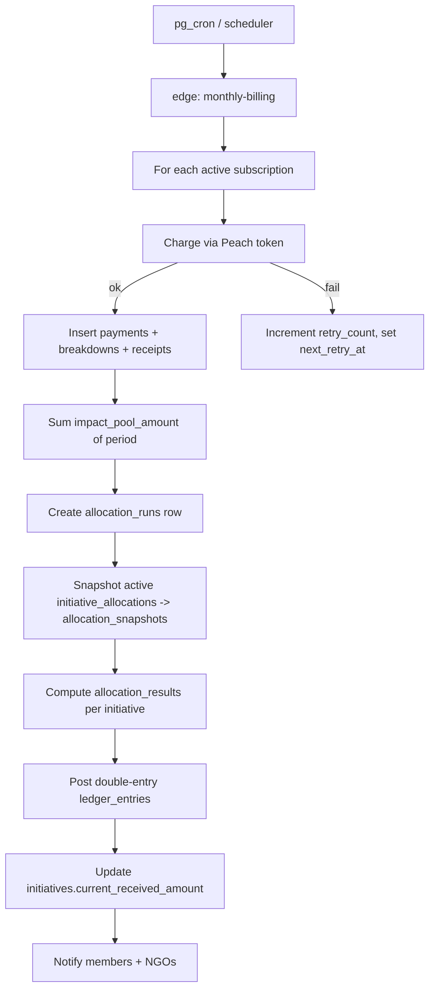
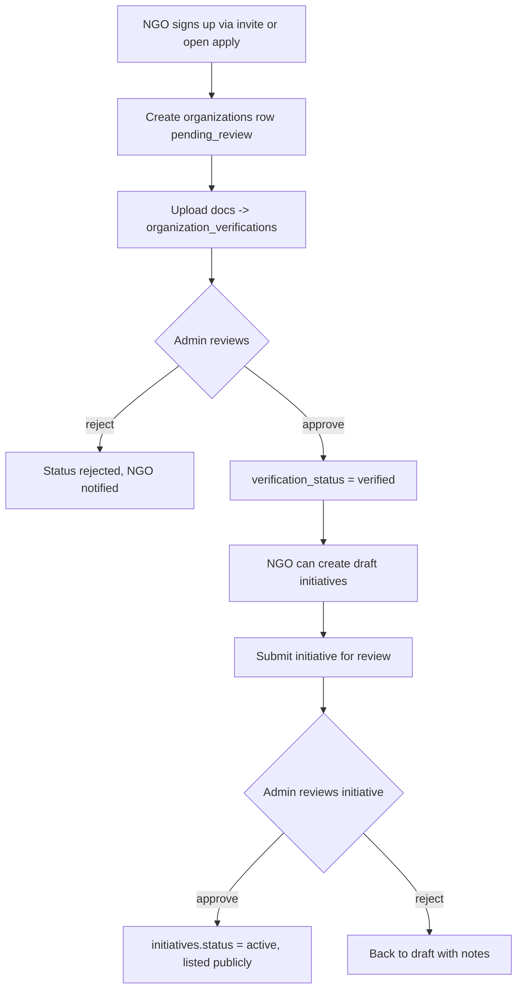
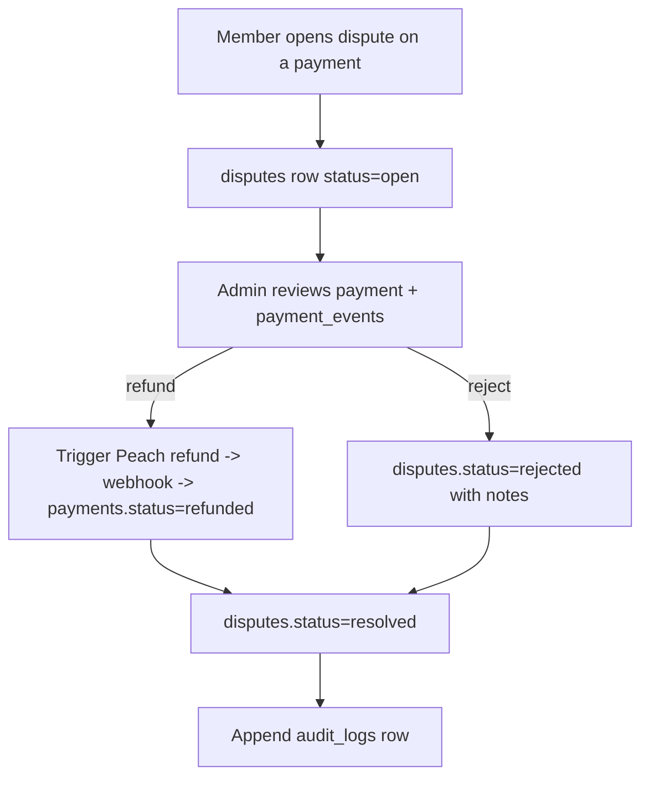
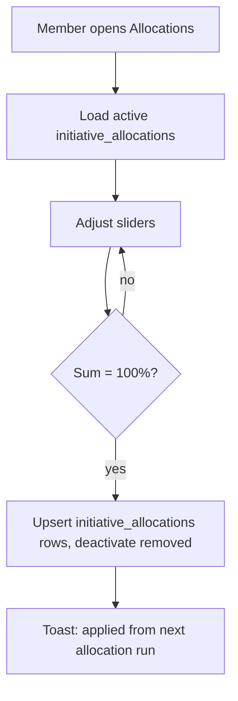

# Web Flows

All diagrams use Mermaid. Render in any Markdown viewer that supports it (GitHub, VS Code with Mermaid extension).

## 1. Signup → first contribution

```mermaid
flowchart TD
  A[Guest visits /] --> B[Clicks Become a Member]
  B --> C[/signup: choose monthly amount/]
  C --> D[Enter email + password]
  D --> E[Supabase Auth: create auth.users]
  E --> F[Trigger creates public.users + member_profiles]
  F --> G[Email verification sent]
  G --> H{Email verified?}
  H -- no --> G
  H -- yes --> I[Create subscriptions row pending_payment]
  I --> J[Edge fn peach-create-checkout]
  J --> K[Redirect to Peach hosted page]
  K --> L[User pays]
  L --> M[Peach webhook -> /api/public/peach-webhook]
  M --> N[Verify HMAC; insert payment_events]
  N --> O[Insert payments + payment_breakdowns + receipts]
  O --> P[subscriptions.lifecycle_status = active]
  P --> Q[/dashboard -> /member]
```

## 2. Auth + role routing

```mermaid
flowchart TD
  L[Login page] --> A[Supabase signIn]
  A --> S{Session?}
  S -- no --> L
  S -- yes --> R[Read users.role via auth_user_id]
  R -->|admin| AD[/admin]
  R -->|ngo| NG[/ngo]
  R -->|member| ME[/member]
```

## 3. Monthly billing & allocation



## 4. NGO onboarding



## 5. Dispute lifecycle



## 6. Member updates allocation


