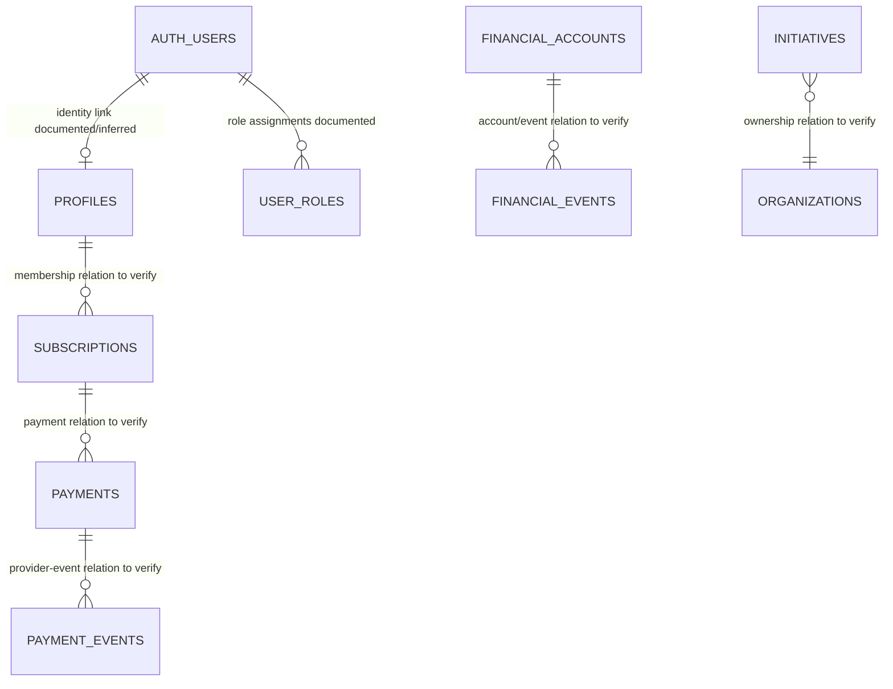

# Entity Relationship Diagram

**Status:** Conceptual only. Entity relationships are not fully verified; do not treat this diagram as a schema migration specification.

The diagram includes conceptual relationships for investigation, not confirmed cardinalities. Verify every FK, uniqueness rule, nullable link and join path from migrations and generated types before calling this an ER model of the current database.
