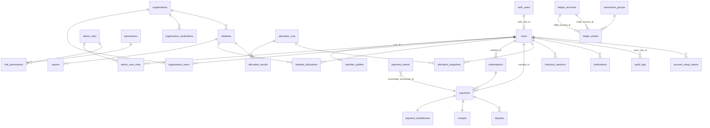

# Backend Schema (annotated)

This documents the **actual** Supabase schema in project `vzsifigcowusabfmnudk`. The frontend builds against this — not the simplified PRD draft.

## ERD (logical)



## Table-by-table notes

### Identity & roles
- **`users`** — domain user. `auth_user_id` FK to `auth.users`. `role` enum `user_role`. `account_status` enum `account_status` (`pending_setup`, `active`, etc.). One row per signup.
- **`account_setup_tokens`** — invite tokens (admin-issued NGO/staff onboarding).
- **`admin_roles`**, **`admin_user_roles`**, **`permissions`**, **`role_permissions`** — fine-grained admin RBAC. Coarse role lives on `users.role`; this layer gates admin sub-actions.

### Members & subscriptions
- **`member_profiles`** — extends `users` for members: `monthly_subscription_amount`, `total_contributed`, `contribution_start_date`. Created on first successful payment.
- **`subscriptions`** — Peach subscription. `lifecycle_status` enum `subscription_status`. Retry fields drive failed-payment recovery.
- **`checkout_sessions`** — short-lived Peach hosted-checkout sessions.

### Payments & accounting
- **`payments`** — one per charge. `payment_status` enum `payment_status`. `processor_fee_covered` toggles whether member absorbed the fee.
- **`payment_breakdowns`** — 1:1 with `payments`. Decomposes the gross into MCB fee, VAT, Peach fee, reserve, platform margin, **impact_pool_amount**, distributable, net profit. This is the transparency primitive.
- **`payment_events`** — raw webhook log, unique on `provider_event_id`. `processing_status` enum `webhook_processing_status`. Idempotency key for the webhook handler.
- **`receipts`** — 1:1 with `payments`, PDF in `receipts` storage bucket. `receipt_number` unique sequential.
- **`disputes`** — opened by member or admin against a payment.
- **`ledger_accounts`** + **`ledger_entries`** + **`transaction_groups`** — double-entry. Every money movement (charge, fee, payout, refund) posts a balanced group. Source of truth for treasury reports.

### Initiatives & allocation
- **`organizations`** — NGO entity. `verification_status` enum `organization_status`.
- **`organization_users`** — membership of users in an org (role `manager` etc.).
- **`organization_verifications`** — uploaded docs + admin review trail.
- **`initiatives`** — programs under an organization. `status` enum `initiative_status`. `current_received_amount` is denormalized; updated by allocation runs.
- **`reports`** — NGO-uploaded transparency reports per initiative.
- **`initiative_allocations`** — member's standing allocation %s. `active = true` rows must sum to 100 per member.
- **`allocation_runs`** — monthly job: `allocation_month`, `total_pool_amount`, `algorithm_version`, `status`, `executed_at`. Immutable once executed.
- **`allocation_snapshots`** — per-member %s as of a run (audit trail; allocations may change later).
- **`allocation_results`** — per-initiative MUR allocated by a run.

### Ops
- **`notifications`** — in-app messages.
- **`audit_logs`** — every admin write. `entity_type`, `entity_id`, `metadata jsonb`.

## RLS policy matrix (target state — to be implemented in Phase 1 migration)

| Table | Member | NGO manager | Admin |
|---|---|---|---|
| `users` | self select/update | self select/update | full select; update via fn |
| `member_profiles` | self select/update | — | full select |
| `subscriptions` | self select; insert via edge fn only | — | full |
| `payments` | self select | initiative-funded payments aggregated only | full |
| `payment_breakdowns` | self via payment | aggregated only | full |
| `payment_events` | — | — | select only |
| `receipts` | self select | — | full |
| `initiative_allocations` | self select/upsert (with sum=100 check) | — | full |
| `organizations` | public select where verified | self (via `organization_users`) | full |
| `organization_verifications` | — | self select; insert | full |
| `initiatives` | public select where active | self select/update where org-linked | full |
| `reports` | public select where published | self CRUD where initiative org-linked | full |
| `allocation_runs/results/snapshots` | public aggregate only | self initiative aggregate | full |
| `ledger_accounts/entries`, `transaction_groups` | — | — | select only |
| `notifications` | self select/update read flag | self | full + insert |
| `audit_logs` | — | — | select only (insert via security-definer fn) |
| `disputes` | self CRUD where opener | — | full |
| `admin_roles/user_roles/permissions/role_permissions` | — | — | full (super-admin perm) |
| `checkout_sessions` | self select | — | full |
| `account_setup_tokens` | — | — | full (insert/select) |

### Helper functions to add
```sql
create or replace function public.has_role(_user uuid, _role user_role)
returns boolean language sql stable security definer set search_path = public as $$
  select exists (select 1 from public.users
    where auth_user_id = _user and role = _role);
$$;

create or replace function public.has_admin_permission(_user uuid, _permission text)
returns boolean language sql stable security definer set search_path = public as $$
  select exists (
    select 1
    from public.users u
    join public.admin_user_roles aur on aur.user_id = u.id
    join public.role_permissions rp on rp.admin_role_id = aur.admin_role_id
    join public.permissions p on p.id = rp.permission_id
    where u.auth_user_id = _user and p.permission_key = _permission
  );
$$;

create or replace function public.is_org_member(_user uuid, _org uuid)
returns boolean language sql stable security definer set search_path = public as $$
  select exists (
    select 1 from public.organization_users ou
    join public.users u on u.id = ou.user_id
    where u.auth_user_id = _user and ou.organization_id = _org
  );
$$;
```

## Storage buckets

| Bucket | Visibility | Notes |
|---|---|---|
| `receipts` | private | Signed URLs only; member can read own. |
| `reports` | mixed | Public when `reports.published = true`; private otherwise. |
| `avatars` | public | User profile pictures. |
| `initiative-media` | public | Hero images for initiatives. |
| `org-docs` | private | Verification documents; admin + org members only. |

## Triggers / functions to add
- `handle_new_auth_user()` — on `auth.users` insert, create `users` (and `member_profiles` if signup origin = member).
- `enforce_allocation_sum_100()` — trigger on `initiative_allocations` upsert.
- `set_updated_at()` — generic timestamp trigger.
- `log_admin_write()` — append to `audit_logs` for tables with admin writes.

All of the above are **planned**, not yet executed. Migrations land in Phase 1.
