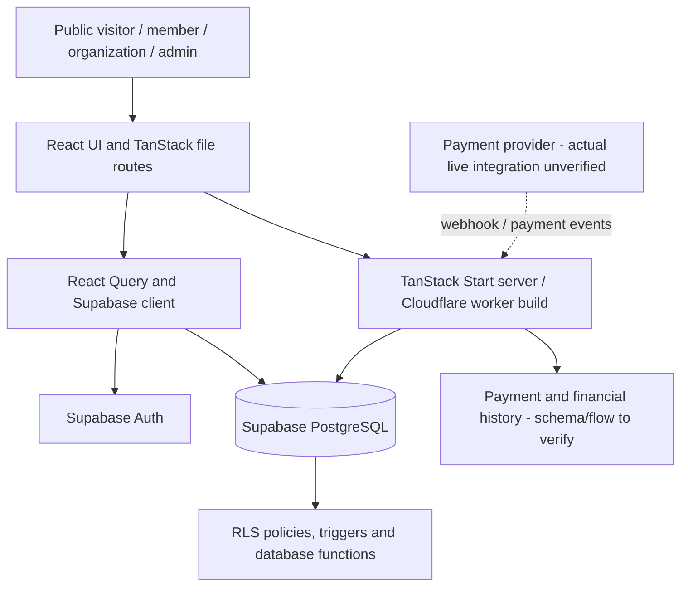

# Repository Audit — Initial Stage

**Status:** Stage 1 initial audit  
**Audit date:** 2026-10-13  
**Branch:** `docs/repository-audit-and-technical-blueprint`  
**Scope:** Read-only review of repository files and indexed code search. No application code, database, production data, or deployment was changed. No tests were run as part of this audit.

## Evidence rules

- **Verified** means directly supported by a repository file or configuration inspected for this report.
- **Prior reported issue** means recorded in existing project documentation or recent project history; it is not proof that the issue still reproduces on the current head.
- **Assumption / unknown** means available repository evidence is insufficient to confirm the live behavior.
- **Proposed** means a recommendation, not current functionality.

## 1. Executive summary

The repository contains a CommonGround social-impact membership and organization-discovery application. The documented product direction includes recurring memberships, member allocation preferences, organization/initiative discovery, impact transparency, administrative moderation, and financial record keeping.

**Verified stack:** React 19, TypeScript, TanStack Start/Router, Vite, Tailwind CSS 4 tooling, Supabase JavaScript client, Supabase Auth/PostgreSQL/Storage configuration, and Playwright end-to-end tests. The package and Vite configuration also show Cloudflare Vite tooling and a custom worker build script.

**Important distinction:** README documentation describes Peach Payments checkout and webhook-confirmed subscription activation as the intended “golden flow.” Separate repository documentation says real Peach Payments integration was deferred and a mock payment provider remains in use. Therefore, real-money payment processing must not be represented as production-ready solely on the basis of README descriptions.

**High-priority risks to resolve:** current signup E2E reliability; source-of-truth differences between README, implementation and operational documentation; local/remote Supabase migration-history drift reported in recent project work; payment integration and webhook security before accepting real money; and a complete current-head review of route authorization, RLS, and API contracts.

## 2. Verified repository facts

| Area | Evidence | Finding |
|---|---|---|
| Repository | GitHub repository metadata | Private repository `commongroundmauritius-sudo/guild-of-givers`; default branch `main`. |
| Package | `package.json` | Package name is `tanstack_start_ts`; scripts include Vite dev/build/preview, ESLint, Prettier and Playwright. |
| UI/runtime | `package.json`, `vite.config.ts` | React 19, TanStack Start/Router, Vite, React Query and Tailwind Vite integration are declared. |
| Hosting build | `package.json`, `vite.config.ts` | Cloudflare Vite plugin is declared; build runs `vite build` followed by `scripts/build-worker.js`. Vite SSR is configured with `noExternal: true` and inline dynamic imports. |
| Backend | `supabase/config.toml`, README | Supabase project ID is configured as `vzsifigcowusabfmnudk`; Supabase Auth, PostgreSQL and Storage are part of the documented architecture. This does not verify live project health. |
| Route example | `src/routes/initiatives/$slug.tsx` | TanStack file-based route exists for initiative detail by slug and imports Supabase/React Query. |
| Root shell | `src/routes/__root.tsx` | Root route uses TanStack Router, React Query provider, AuthProvider, Supabase client, toast and tooltip UI components. |
| E2E | `playwright.config.ts` | Tests live under `tests/`; Chromium project; default base URL is localhost:8080; CI retries once and uses a 20-second test timeout. |
| Auth test config | `supabase/config.toml` | Local Supabase Auth email confirmations are disabled for local/CI signup testing. This does not establish production Auth settings. |
| Security principles | `AGENTS.md`, migration search results | Project guidance calls for backend-authoritative sensitive operations, role checks, RLS, verified webhook-only payment confirmation, and preservation of financial history. Guidance is not proof every code path complies. |
| Existing docs | `README.md`, `docs/MIGRATIONS.md`, `docs/AUDITS.md`, `GAP_ANALYSIS.md`, `docs/PRODUCTION_AUDIT_2026-09-13.md` | Several existing design/audit documents exist. They must be reconciled with current code instead of treated as automatically current. |

## 3. Product scope inferred from existing documentation

These are documented product capabilities or intended workflows; each still needs implementation-level verification during later stages.

- Membership signup and recurring subscription management.
- Organization discovery and initiative detail pages.
- Member preference/ranking for how platform allocations should be directed.
- Organization profiles, initiatives and transparency reporting.
- Admin approval/moderation and operational dashboards.
- Financial event/payment history and reporting.
- Notifications, community features and content moderation where implemented in routes/components.
- Impact attribution and campaign sharing where implemented in route and service code.

The product terminology and the exact financial model require a single approved source of truth. Existing documents use “contribution,” “donation,” “subscription,” and Peach-payment language in different contexts. Current product positioning and legal wording must be decided explicitly and reflected consistently.

## 4. Main workflows and known state

### 4.1 Signup and account creation

**Verified:** a Playwright test named `tests/e2e-signup-journey.spec.ts` is referenced by the production-validation workflow, and the test configuration runs Playwright against a local worker/base URL.

**Prior reported issue:** project history records recent failure of this journey during account creation, after earlier failures involving step transition. The current root cause has not been independently reproduced in this read-only audit. Investigate browser console/network output, Auth response, route transitions, form validation and worker logs before changing assertions.

### 4.2 Payment and subscription

**Verified:** README describes a Peach checkout/webhook flow; `docs/PRODUCTION_AUDIT_2026-09-13.md` says real Peach Payments was intentionally deferred and lists work required before real-money launch. `GAP_ANALYSIS.md` also lists payment webhooks and allocation backend work as gaps.

**Conclusion:** payment readiness is **not verified**. Determine the actual provider implementation, environment gating, subscription writes, idempotency, webhook signature verification, reconciliation and failure/retry behavior from current code before documenting an operational API contract.

### 4.3 Database migrations

**Verified:** Supabase configuration and a migrations directory are present; `docs/MIGRATIONS.md` documents the migration process.

**Prior reported issue:** project history records remote Supabase migration versions missing from the local migrations directory and a local/remote migration mismatch. The exact current difference has not been measured in this audit. Do not apply, reset, or modify the production database as part of documentation work. Establish a read-only migration inventory and compare version lists before proposing a repair.

## 5. Detected technology stack

| Layer | Detected technology | Confidence / notes |
|---|---|---|
| Language | TypeScript / JavaScript | High; package and source files. |
| UI | React 19 | High; dependency declaration. |
| Routing/full-stack framework | TanStack Start and TanStack Router | High; dependencies and route files. |
| Build tooling | Vite, Cloudflare Vite plugin, custom worker build | High; package and Vite config. |
| Styling/UI | Tailwind CSS Vite integration, Radix UI, Lucide React, custom UI components | High for declared dependencies; exact design tokens remain to be inventoried. |
| Server/data client | Supabase JavaScript client | High; dependency and source imports. |
| Data/auth/storage service | Supabase/PostgreSQL/Auth/Storage | High as configured/documented; live state not checked. |
| Client data state | TanStack React Query | High; dependency and root provider. |
| Forms | React Hook Form and resolver package | High for dependencies; usage needs code inventory. |
| Testing | Playwright | High; configuration and workflow reference. |
| Code quality | ESLint and Prettier | High; package scripts. |
| Deployment target | Cloudflare worker/runtime appears intended | Medium-high; build tooling is present, but deployed production configuration was not checked. |
| Payments | Peach described, real integration deferred in existing audit | Current implementation must be inspected; do not assume Peach is active. |

## 6. Architecture summary

The repository indicates a file-routed React/TanStack application with a shared root shell and Supabase client access. Supabase is intended to provide authentication and PostgreSQL persistence, with RLS/database functions/triggers enforcing trusted business rules. Vite builds the application and invokes a custom worker build step.

The diagram intentionally marks the payment provider as unverified. Later TRD work must refine this diagram from concrete server functions, edge functions, migrations, and call sites.

## 7. User roles and permissions

Existing project guidance/documentation names members, organizations, admins and role-based access via `user_roles`. Current implementation details must be verified across route guards, database policies and server operations.

Audit requirements for later stages:
- Enumerate role values and their canonical source.
- Map each protected route and action to its authorization check.
- Confirm a user cannot grant their own role or write another user's organization/member data.
- Review public reads separately from authenticated reads and writes.
- Verify role initialization trigger behavior and account deletion/role cleanup.
- Compare application-level checks with database RLS; client-side hiding alone is insufficient.

## 8. Database entities and relationships — preliminary only

Existing README/search evidence names `auth.users`, `profiles`, `user_roles`, `subscriptions`, `payments`, `payment_events`, `financial_events`, `initiatives`, and `financial_accounts`. Other schema entities likely exist, but this list is not a complete schema inventory.

No production schema has been queried for this report. Table columns, constraints, indexes, foreign keys, triggers, RLS policies and live migration status remain **unverified**. The database documentation stage must reconstruct these from every relevant migration and generated Supabase types, then label any production comparison unavailable.

## 9. External integration points

- **Supabase:** Auth, database and storage are configured/documented. Production configuration and access policy state were not inspected.
- **Cloudflare:** build plugin and worker build script are declared. Live deployment, bindings and environment configuration were not inspected.
- **Peach Payments:** described in documentation, but real integration is explicitly described as deferred in an existing production audit. Treat as not launch-ready until code and provider configuration prove otherwise.
- **Email/notifications/analytics:** inventory actual call sites and environment variable names in later stages; no completeness claim is made here.

Secrets, access tokens and production credentials are intentionally excluded.

## 10. Major risks and recommended priorities

| Priority | Risk / gap | Why it matters | Next verification |
|---|---|---|---|
| P0 | Real payment readiness unclear / Peach integration previously deferred | Risk of incorrect subscription activation, duplicate charges, or false payment status | Trace provider abstraction, server endpoints/functions, webhook validation, idempotency and reconciliation. Keep real-money processing disabled until verified. |
| P0 | Signup E2E has recent reported failures | Core onboarding may be broken or test environment may not match the flow | Re-run the exact CI workflow and inspect trace, console, network, worker and Supabase Auth responses. |
| P0 | Remote/local migration drift previously reported | Deployments and clean database setup can fail or diverge | Compare local migration filenames with remote migration history using read-only access; do not reset or push changes during audit. |
| P1 | Existing documentation may be stale or contradictory | Engineers may implement against intended rather than actual behavior | Mark every claim verified/inferred/proposed and reconcile README, audits, gap analysis and source. |
| P1 | Authorization coverage not yet mapped end-to-end | RLS gaps or route-level omissions could expose private/financial data | Build route/action-to-role-to-policy matrix and test negative access cases. |
| P1 | API/server-action inventory incomplete | Client contracts and error behavior may be undocumented | Search route handlers, server functions, Supabase functions, RPC calls and webhooks. |
| P1 | Financial data invariants need full verification | Audit history must remain trustworthy and consistent | Trace financial tables, deletion behavior, transaction boundaries and append-only controls. |
| P2 | Accessibility and responsive design not yet systematically audited | Users may encounter barriers across screens | Inventory tokens/components, run automated checks, and manually review keyboard/focus/contrast. |
| P2 | Observability/recovery not confirmed | Signup/payment incidents may be hard to diagnose | Inventory logs, error reporting, alerting, backup/restore evidence and incident procedures. |

## 11. Incomplete, duplicated or inconsistent documentation signals

1. The README describes Peach as the payment provider and presents the webhook golden flow; the September production audit says real Peach is deferred.
2. `GAP_ANALYSIS.md` describes allocation and payment work as gaps; those statements need comparison with current implementation and newer commits.
3. Historical audit documents may describe prior migration or CI states. They should be treated as historical until revalidated.
4. Project terminology varies between contribution, donation, membership and subscription. This is both a product/documentation consistency issue and a legal/compliance decision.
5. No complete route/API/schema inventory has yet been established in this audit.

## 12. Unresolved decisions and missing evidence

- Is the canonical product currently CommonGround, or is the planned Citizen+ rebrand in scope for this documentation? This audit preserves the repository's current CommonGround terminology.
- What exact membership tiers, benefits, allocation rules, and Impact Pool rules are approved product requirements versus proposed business changes?
- Is Peach integration still deferred on the current branch, and is any real-money path enabled in any environment?
- Which Cloudflare environment is authoritative for production, and where are bindings/secrets configured (names only; never values)?
- Can the connected Supabase project's migration history and schema be inspected read-only for comparison? Until then, live schema status is unknown.
- Which existing audit/gap documents remain authoritative, and which are historical?
- What are the approved retention, deletion, refund, cancellation, receipt and financial-reconciliation policies?

## 13. Validation record

| Check | Status | Notes |
|---|---|---|
| Repository metadata | Complete | Private repo; default branch `main`. |
| Package manifest | Partial | Core dependencies/scripts inspected; full dependency-to-code usage audit remains. |
| Main Vite configuration | Complete for initial stack detection | `vite.config.ts` inspected. |
| Root route | Partial | Opening section and provider imports inspected; full root behavior remains to review. |
| Representative dynamic route | Partial | Initiative slug route discovered through code search. |
| Supabase config | Complete for visible local config | Does not establish production configuration or live health. |
| Playwright config/workflow | Partial | Test config inspected; workflow and failure trace need full review. |
| Migrations/schema/RLS | Partial | Search evidence only; complete inventory and live comparison outstanding. |
| Tests executed | Not performed | No claim of successful test execution. |
| Application run/deployment checked | Not performed | No claim that the application or production environment was run. |
| Production data inspected | Not performed | No production data was read or changed. |

## 14. Stage 1 exit criteria

Stage 1 is an initial audit, not a complete reverse-engineering sign-off. Before declaring the repository audit final:
- inventory every route and screen;
- inspect server routes/actions, Supabase Edge Functions, migrations, generated database types and RLS policies;
- inspect CI workflows and the latest signup E2E trace;
- map role checks and sensitive operations;
- compare actual implementation against existing audit/gap documents;
- verify diagram accuracy against discovered call paths.

**Next stage:** generate the PRD and stable requirement inventory, preserving verified, inferred and proposed behavior as separate categories.
